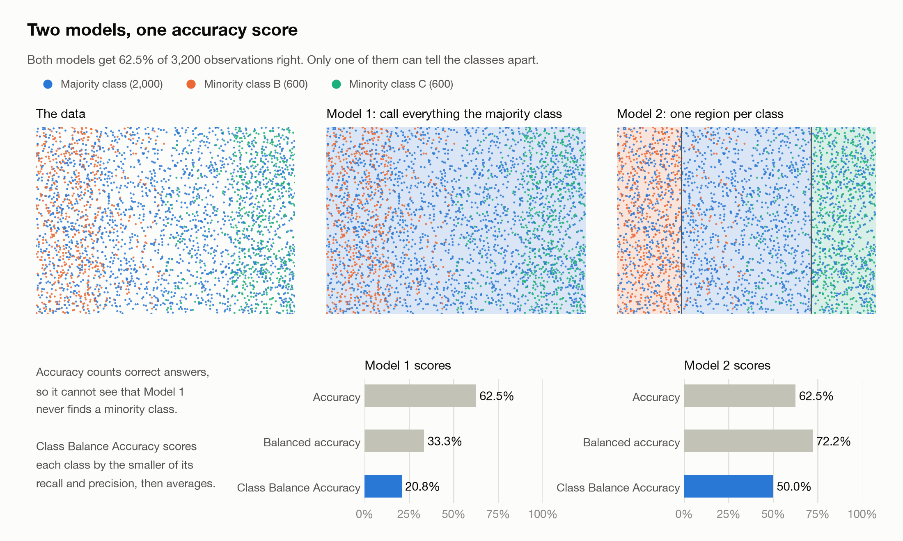
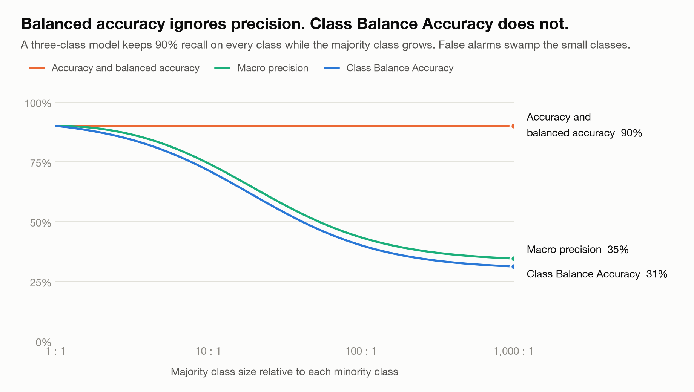
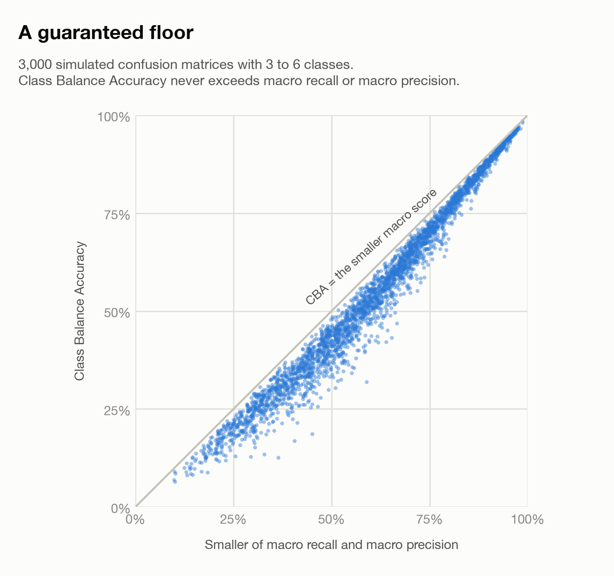
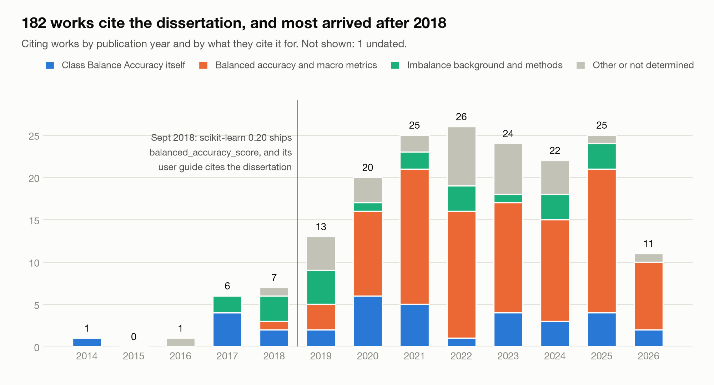
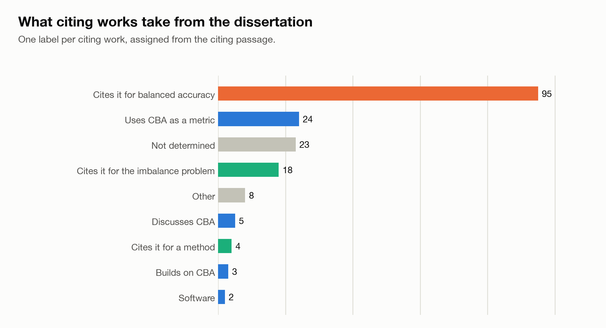
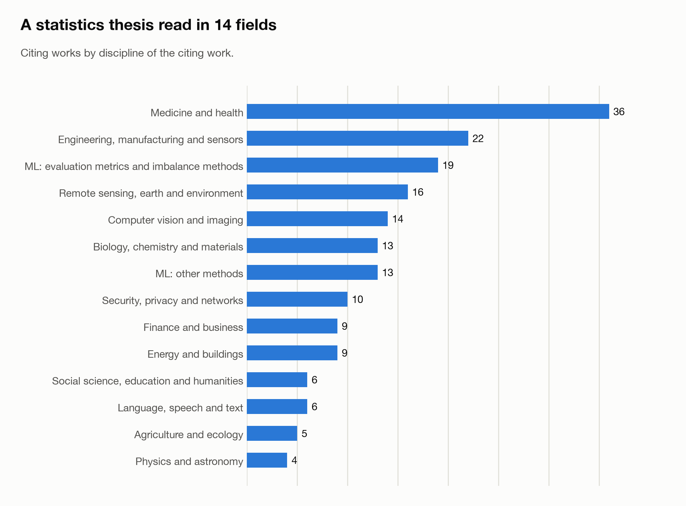
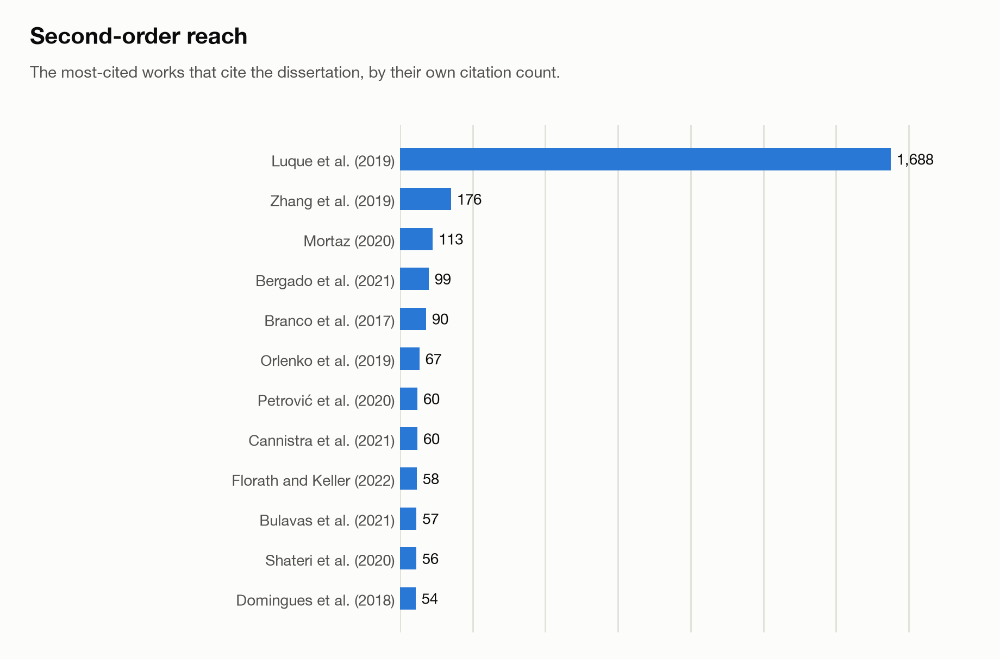
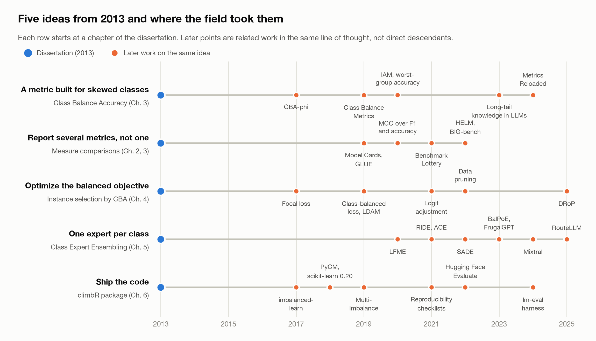

# A Balanced Approach to the Multi-Class Imbalance Problem

**Lawrence Mosley · PhD dissertation · Iowa State University · 2013**

When one class dwarfs the others, accuracy rewards a model for ignoring the rare ones. This dissertation proposed **Class Balance Accuracy (CBA)**, a metric that scores every class by the weaker of its recall and precision, and then used it to select training data and to build ensembles of per-class experts.

This repository is a home for that work and a guide to the field around it: what the metric is, how to compute it, who has used it, and how its ideas connect to imbalance research today.

**[Read the dissertation](https://doi.org/10.31274/etd-180810-3375)** · **[Explore the interactive site](https://omni-analytics-group.github.io/a_balanced_approach_to_the_multi-class_imbalance_problem/)** · **[Browse all 182 citing works](data/CITING_WORKS.md)** · **[How to cite](#how-to-cite)**

| | |
|---|---|
| **167** citations on Google Scholar (November 2026) | **182** distinct citing works traced across four sources |
| **34** works use, extend, discuss, or implement CBA | **14** disciplines, from medicine to astronomy |
| Authors in **32** countries, writing in **11** languages | Cited in the **scikit-learn user guide** since version 0.20 (2018) |

## Contents

- [The problem in one picture](#the-problem-in-one-picture)
- [Class Balance Accuracy](#class-balance-accuracy)
- [What else is in the dissertation](#what-else-is-in-the-dissertation)
- [Where the work went](#where-the-work-went)
- [From 2013 to modern AI](#from-2013-to-modern-ai)
- [Software](#software)
- [Reading list](#reading-list)
- [How to cite](#how-to-cite)
- [How this page was built](#how-this-page-was-built)
- [Add your work](#add-your-work)

## The problem in one picture

Take 3,200 observations: 2,000 in a majority class and 600 in each of two minority classes. One model calls everything the majority class. Another carves out a region for each class. Both are right 62.5% of the time. Accuracy cannot tell them apart.

<picture>
  <source media="(prefers-color-scheme: dark)" srcset="figures/same-accuracy-dark.png">
  
</picture>

This is Figure 3.1 of the dissertation, recomputed from [`src/cba.py`](src/cba.py). Class Balance Accuracy gives the first model 20.8% and the second 50.0%.

## Class Balance Accuracy

For a confusion matrix with *k* classes, where *c<sub>ii</sub>* counts the correct predictions for class *i*, *c<sub>i·</sub>* is the number of true members of class *i* (the row total), and *c<sub>·i</sub>* is the number of predictions made for class *i* (the column total):

$$
\mathrm{CBA} = \frac{1}{k} \sum_{i=1}^{k} \frac{c_{ii}}{\max\left(c_{i\cdot},\ c_{\cdot i}\right)}
$$

Dividing by the larger of the two totals keeps the smaller of recall and precision for each class. Three properties follow.

- **Every class counts equally.** A class with 50 members weighs as much as a class with 50,000.
- **It is a floor.** CBA never exceeds macro recall or macro precision (Theorem 3.2.1). A CBA of 0.80 guarantees both are at least 0.80.
- **It sees both kinds of error.** A model cannot raise its score by flooding a rare class with predictions, and it cannot raise it by never predicting that class.

### CBA is not balanced accuracy

The two names are close and the metrics are not the same. Balanced accuracy is the mean of per-class recall. It ignores precision.

| Metric | Per class it uses | Notices false alarms on rare classes |
|---|---|---|
| Accuracy | nothing per class | only in the total |
| Balanced accuracy (macro recall) | recall | no |
| Macro precision | precision | yes |
| **Class Balance Accuracy** | **min(recall, precision)** | **yes** |

The gap matters most when imbalance is severe. Hold recall at 90% for every class and grow the majority class. Accuracy and balanced accuracy stay at 90%. Most predictions for the small classes are now false alarms, and only precision and CBA register it.

<picture>
  <source media="(prefers-color-scheme: dark)" srcset="figures/precision-blind-spot-dark.png">
  
</picture>

The lower bound holds on every confusion matrix. Here it is on 3,000 simulated ones.

<p align="center">
<picture>
  <source media="(prefers-color-scheme: dark)" srcset="figures/lower-bound-dark.png">
  
</picture>
</p>

### Compute it

Python, with no dependencies ([`src/cba.py`](src/cba.py)):

```python
from src.cba import class_balance_accuracy, confusion_matrix

matrix = confusion_matrix(y_true, y_pred)      # rows are true classes, columns are predictions
class_balance_accuracy(matrix)

class_balance_accuracy([[1000, 500, 500],
                        [ 100, 500,   0],
                        [ 100,   0, 500]])     # 0.5
```

R ([`R/cba.R`](R/cba.R)):

```r
source("R/cba.R")
class_balance_accuracy(table(actual, predicted))
```

With [PyCM](https://www.pycm.io/doc/index.html#cba), which has shipped CBA since version 1.4:

```python
from pycm import ConfusionMatrix
ConfusionMatrix(actual_vector=y_true, predict_vector=y_pred).CBA
```

With scikit-learn and NumPy:

```python
import numpy as np
from sklearn.metrics import confusion_matrix

cm = confusion_matrix(y_true, y_pred)
cba = np.mean(np.diag(cm) / np.maximum(cm.sum(axis=0), cm.sum(axis=1)))
```

`sklearn.metrics.balanced_accuracy_score` computes macro recall, not CBA.

## What else is in the dissertation

CBA is Chapter 3. The other chapters put the metric to work.

- **A review of multi-class measures (Chapter 2).** Accuracy, balanced accuracy, G-mean, F-score, the Matthews correlation coefficient, confusion entropy, and relative classifier information, compared on what each one hides when classes are skewed.
- **Instance selection with a balanced objective (Chapter 4).** Choosing which training observations to keep is usually tuned for accuracy. Tuning for CBA instead improved accuracy and per-class recall when the classes overlap.
- **Class Expert Ensembling (Chapter 5).** Fit many different models. Use an assignment program to pick the best one for each class. Predict in sequence, one expert and one class at a time. It beat AdaBoost on some of the UCI test sets.
- **climbR (Chapter 6).** An open-source R package for imbalance metrics and models, with a call for one shared home for imbalance tools.

## Where the work went

Google Scholar listed 167 citations on November 10, 2026. Merging that list with Semantic Scholar, OpenAlex, and the reading list this repository kept in 2022 gives **182 distinct citing works**. 29 of them do not appear in Scholar's list. The citing passage was read in 159 of the 182 to see what each work took from the dissertation.

<picture>
  <source media="(prefers-color-scheme: dark)" srcset="figures/citations-by-year-dark.png">
  
</picture>

### It is in the scikit-learn user guide

In September 2018, scikit-learn 0.20 added `balanced_accuracy_score`. The [user guide section](https://scikit-learn.org/stable/modules/model_evaluation.html#balanced-accuracy-score) that documents it names the dissertation twice: once among the sources for its multi-class definition, and once to describe "class balanced accuracy" as the average, over classes, of the minimum of precision and recall. Citations rose from 15 in the five years before 2019 to 166 since.

The guide lists the reference as "IJCV 2010". That is an error. The work is a 2013 Iowa State University dissertation, and the mistake has been copied into several papers. A fix to the scikit-learn documentation would be a welcome contribution.

### What citing works take from it

<picture>
  <source media="(prefers-color-scheme: dark)" srcset="figures/usage-dark.png">
  
</picture>

- **3 papers build new metrics on CBA.** Branco, Torgo, and Ribeiro (2017) weight it by class relevance. Luque and colleagues (2019), in a *Pattern Recognition* paper with more than 1,600 citations of its own, extend the idea into a family of Class Balance Metrics. Mortaz (2020) builds the Imbalance Accuracy Metric on it and proves bounds that tie the two together.
- **24 works use CBA as a metric in their own experiments**, and 27 works report CBA values. The applications include sickle-cell diagnosis from blood smears, wildfire burn prediction at a 0.006% positive rate, RFID tag tracking in retail, opioid prescribing after surgery, wastewater odor classification, protein structure prediction, satellite characterization from light curves, and student grade prediction. The full list is below.
- **5 works discuss CBA** in reviews of evaluation practice, in fields from brain-computer interfaces to legal text generation.
- **95 works cite the dissertation for balanced accuracy** or for macro-averaged metrics in general. Most follow the scikit-learn reference. They cite the right problem and a neighboring metric. If that is you, the [comparison above](#cba-is-not-balanced-accuracy) shows what CBA adds.
- **22 works cite it for the imbalance problem itself** or for a method of handling it.
- 8 works cite it for something else, such as a general list of confusion-matrix measures. For 23 more, the citing passage could not be read (paywalls, missing files) or the dissertation appears only in the reference list.

<details>
<summary><strong>Every work that uses, extends, discusses, or implements CBA (34)</strong></summary>

| Year | Work | Use | Subject |
|---|---|---|---|
| 2017 | [Branco et al. (2017)](https://doi.org/10.1007/978-3-319-57454-7_54), *Relevance-Based Evaluation Metrics for Multi-class Imbalanced Domains* | Builds on CBA | multi-class imbalanced evaluation metrics |
| 2019 | [Luque et al. (2019)](https://doi.org/10.1016/j.patcog.2019.02.023), *The impact of class imbalance in classification performance metrics based on the binary confusion matrix* | Builds on CBA | machine learning: performance metrics under class imbalance |
| 2020 | [Mortaz (2020)](https://doi.org/10.1016/j.knosys.2020.106490), *Imbalance accuracy metric for model selection in multi-class imbalance classification problems* | Builds on CBA | metric proposal for multi-class imbalanced model selection |
| 2017 | [Hauser et al. (2017)](https://doi.org/10.1109/rfid.2017.7945604), *A hidden Markov model for distinguishing between RFID-tagged objects in adjacent areas* | Uses CBA as a metric | IoT/retail: RFID tag area classification in smart fitting rooms |
| 2017 | [Weigand (2017)](https://elib.dlr.de/111835/), *SAR Image Feature Analysis for Slum Detection in Megacities* | Uses CBA as a metric | remote sensing: SAR slum detection in Mumbai |
| 2017 | [Sem (2017)](https://repozitorij.uni-lj.si/IzpisGradiva.php?id=92287), *Uvrščanje neuravnoteženih visoko razsežnih podatkov v več razredov : doktorsko delo* | Uses CBA as a metric | high-dimensional spectroscopic data, multi-class imbalanced classification |
| 2018 | [Pereira (2018)](https://doi.org/10.11606/t.95.2018.tde-03052018-095932), *Redes neurais residuais profundas e autômatos celulares como modelos para predição que fornecem informação sobre a formação de estruturas secundárias proteicas* | Uses CBA as a metric | bioinformatics: protein secondary structure prediction |
| 2020 | [Delgado-Font et al. (2020)](https://doi.org/10.1007/s11517-019-02085-9), *Diagnosis support of sickle cell anemia by classifying red blood cell shape in peripheral blood images* | Uses CBA as a metric | medicine: sickle cell anemia red blood cell shape classification |
| 2020 | [Bergado (2020)](https://doi.org/10.3990/1.9789036550963), *End-to-end predictive models for remote sensing applications* | Uses CBA as a metric | remote sensing: wildfire burn prediction |
| 2020 | [Miró-Nicolau et al. (2020)](https://doi.org/10.1007/s11042-023-15382-1), *Segmenting overlapped objects in images. A study to support the diagnosis of sickle cell disease* | Uses CBA as a metric | image analysis: segmenting overlapped objects such as sickle cell images |
| 2020 | [Petrović et al. (2020)](https://doi.org/10.1016/j.compbiomed.2020.104027), *Sickle-cell disease diagnosis support selecting the most appropriate machine learning method: Towards a general and interpretable approach for cell morphology analysis from microscopy images* | Uses CBA as a metric | medicine: sickle-cell disease red blood cell morphology from microscopy images |
| 2021 | [Khuat and Gabrys (2021)](https://doi.org/10.1016/j.neucom.2021.08.083), *An in-depth comparison of methods handling mixed-attribute data for general fuzzy min–max neural network* | Uses CBA as a metric | ML: fuzzy min-max neural networks, mixed-attribute tabular data |
| 2021 | [Khuat (2021)](https://opus.lib.uts.edu.au/handle/10453/154753), *Development of Robust and Scalable Hyperbox based Machine Learning Algorithms* | Uses CBA as a metric | hyperbox fuzzy min-max neural networks, mixed-attribute classification |
| 2021 | [Ongko and Hartono (2021)](https://doi.org/10.11591/eei.v10i3.3057), *Hybrid approach redefinition-multi class with resampling and feature selection for multi-class imbalance with overlapping and noise* | Uses CBA as a metric | ML: multi-class imbalance with overlap and noise on UCI datasets |
| 2021 | [Bergado et al. (2021)](https://doi.org/10.1016/j.ssci.2021.105276), *Predicting wildfire burns from big geodata using deep learning* | Uses CBA as a metric | remote sensing: wildfire burn prediction from geodata |
| 2021 | [Mortaz et al. (2021)](https://doi.org/10.1080/2573234x.2021.1873078), *Short-term prediction of opioid prescribing patterns for orthopaedic surgical procedures: a machine learning framework* | Uses CBA as a metric | medicine: opioid prescribing prediction after orthopaedic surgery |
| 2022 | [Rudar et al. (2022)](https://doi.org/10.1186/s12859-022-04631-z), *LANDMark: an ensemble approach to the supervised selection of biomarkers in high-throughput sequencing data* | Uses CBA as a metric | bioinformatics: biomarker selection in high-throughput sequencing (metabarcoding) |
| 2023 | [Ma et al. (2023)](https://doi.org/10.1016/j.eswa.2023.122565), *A membership-based resampling and cleaning algorithm for multi-class imbalanced overlapping data* | Uses CBA as a metric | machine learning: resampling for multi-class imbalanced overlapping data |
| 2023 | [Khuat and Gabrys (2023)](https://doi.org/10.1016/j.asoc.2023.110152), *An online learning algorithm for a neuro-fuzzy classifier with mixed-attribute data* | Uses CBA as a metric | fuzzy min-max neural network, mixed-attribute online learning on UCI datasets |
| 2023 | [Hartono and Ongko (2023)](https://doi.org/10.30630/joiv.7.1.1292), *Hybrid Approach with Distance Feature for Multi-Class Imbalanced Datasets* | Uses CBA as a metric | machine learning: multi-class imbalance with overlap (SMOTE hybrid) |
| 2023 | [Kotrlý (2023)](https://theses.cz/id/i7rpi9), *Klasifikace kolejových vozidel* | Uses CBA as a metric | Computer vision: classification of rail vehicles from images |
| 2024 | [Rubio et al. (2024)](https://doi.org/10.1038/s41598-024-51591-w), *Crowdsourced human-based computational approach for tagging peripheral blood smear sample images from Sickle Cell Disease patients using non-expert users* | Uses CBA as a metric | peripheral blood smear cells (sickle cell disease) tagged by crowd workers |
| 2024 | [Chi et al. (2024)](https://doi.org/10.1109/jsen.2024.3447122), *Defect Detection and Localization in Fiber-Optic Panels Based on Discrete Wavelet and Multiobjective Morphological Optimization* | Uses CBA as a metric | engineering: fiber-optic panel defect detection and localization (space optics) |
| 2024 | [Distefano et al. (2024)](https://doi.org/10.1016/j.seps.2024.102021), *Multi-class random forest model to classify wastewater treatment imbalanced data* | Uses CBA as a metric | environmental engineering: odor source classification at a wastewater treatment plant |
| 2025 | [Spasić and Tomašević (2025)](https://rimsi.imsi.bg.ac.rs/handle/123456789/3684), *Classification and forecasting in students' progress using Multiple-Criteria Decision Making, K-Nearest Neighbors, and Multilayer Perceptron methods* | Uses CBA as a metric | education: student grade classification |
| 2025 | [Macmanus et al. (2025)](https://doi.org/10.64861/qsbt6539), *Dual-band Characterisation of Low-Earth Orbit Satellites Using Machine Learning Techniques* | Uses CBA as a metric | space domain awareness: satellite characterization from light curves |
| 2025 | [McInerney et al. (2025)](https://doi.org/10.1371/journal.pone.0322771), *Identifying primary-care features associated with complex mental health difficulties* | Uses CBA as a metric | medicine: primary-care records, complex mental health difficulties |
| 2014 | [Bennette (2014)](https://doi.org/10.31274/etd-180810-2809), *Instance selection for model-based classifiers* | Discusses CBA | instance selection for model-based classifiers |
| 2020 | [Martel et al. (2020)](https://doi.org/10.1109/ijcnn48605.2020.9207243), *Evaluation criteria for closed-loop adaptive dynamic discrete-continuous brain-computer interfaces: clinical study case with tetraplegic patient* | Discusses CBA | brain-computer interfaces: evaluation criteria for a clinical study with a tetraplegic patient |
| 2025 | [Le et al. (2025)](https://doi.org/10.1109/tnnls.2025.3622490), *On Imbalance in Case Types: Evaluating and Enhancing PLMs for Criminal Court View Generation* | Discusses CBA | legal NLP: criminal court view generation |
| 2026 | [Acharya et al. (2026)](https://doi.org/10.1186/s12874-026-02899-w), *Challenges and recent advances in methods for handling imbalanced multiclass classification problems: a methodological review* | Discusses CBA | methodological review: multiclass imbalance in health science |
| 2026 | [Wang et al. (2026)](https://doi.org/10.1007/s44443-026-00547-3), *Class overlap in imbalanced learning: A data-level perspective and comprehensive review* | Discusses CBA | review of class overlap in imbalanced learning |
| 2018 | [Haghighi et al. (2018)](https://www.pycm.io/doc/index.html#cba), *PyCM: Multiclass confusion matrix library in Python* | Software | confusion-matrix software library |
| 2019 | [Zhang et al. (2019)](https://doi.org/10.1016/j.knosys.2019.03.001), *Multi-Imbalance: An open-source software for multi-class imbalance learning* | Software | software for multi-class imbalance learning |

</details>

### Who reads it

<picture>
  <source media="(prefers-color-scheme: dark)" srcset="figures/disciplines-dark.png">
  
</picture>

Medicine and health is the largest group. Rare diagnoses are the textbook imbalanced problem. Most of the rest is applied work: remote sensing, sensors and manufacturing, energy systems, biology, security. 61 of the citing works center on deep neural networks.

The reach is wide in other ways too. Authors come from at least 32 countries (affiliations are known for 112 of the works). 43 of the citing works are theses. 18 are written in languages other than English, including Indonesian, Spanish, Portuguese, Slovenian, Turkish, French, Korean, and Chinese. One is a United States patent.

<picture>
  <source media="(prefers-color-scheme: dark)" srcset="figures/reach-dark.png">
  
</picture>

**All 182 citing works, with links, the use label, and a one-line summary of each: [data/CITING_WORKS.md](data/CITING_WORKS.md)** (grouped by discipline) or [data/citations.csv](data/citations.csv) (one row per work).

## From 2013 to modern AI

The dissertation made five moves that later became common practice. The later work below follows the same line of thought. It does not necessarily descend from the dissertation, and most of it does not cite it.

<picture>
  <source media="(prefers-color-scheme: dark)" srcset="figures/idea-lineage-dark.png">
  
</picture>

| In the dissertation (2013) | The same idea today |
|---|---|
| **A metric built for skewed classes.** CBA scores each class separately and takes the conservative side. | New imbalance-aware metrics keep arriving, three of them built on CBA. [Metrics Reloaded](https://doi.org/10.1038/s41592-023-02151-z) (2024) makes class imbalance one of the first questions to answer when choosing a validation metric for image analysis. Long-tailed benchmarks report many-shot, medium-shot, and few-shot accuracy separately for the same reason. |
| **Report several metrics, not one.** Chapters 2 and 3 line up seven measures on the same confusion matrices and show where each fails. | [Model Cards](https://doi.org/10.1145/3287560.3287596) (2019) ask for results broken out by group. Chicco and Jurman (2020) make [the case for MCC over F1 and accuracy](https://doi.org/10.1186/s12864-019-6413-7). [HELM](https://arxiv.org/abs/2211.09110) (2022) scores language models on seven metrics across dozens of scenarios, because no single number describes a model. |
| **Optimize the balanced objective.** Chapter 4 selects training data to maximize CBA instead of accuracy. | Deep learning moved the same goal into the loss: [focal loss](https://doi.org/10.1109/ICCV.2017.324) (2017), [class-balanced loss](https://doi.org/10.1109/CVPR.2019.00949) and [LDAM](https://arxiv.org/abs/1906.07413) (2019), and [logit adjustment](https://arxiv.org/abs/2007.07314) (2021), which is consistent for balanced error. [Decoupled training](https://arxiv.org/abs/1910.09217) (2020) rebalances only the classifier. |
| **One expert per class.** Class Expert Ensembling assigns the best model to each class and lets it claim its observations. | Mixture of experts dates to [Jacobs et al.](https://doi.org/10.1162/neco.1991.3.1.79) (1991). Long-tailed recognition rebuilt it around class frequency: [LFME](https://arxiv.org/abs/2001.01536) (2020), [RIDE](https://arxiv.org/abs/2010.01809) and [ACE](https://arxiv.org/abs/2108.02385) (2021), [SADE](https://arxiv.org/abs/2107.09249) (2022), and [BalPoE](https://arxiv.org/abs/2206.05260) (2023) train experts for head and tail classes and combine them. Sparse expert routing now runs inside large language models such as [Mixtral](https://arxiv.org/abs/2401.04088) (2024). |
| **Ship the code.** The dissertation ends with the climbR package and a call for a shared repository of imbalance tools. | [imbalanced-learn](https://jmlr.org/papers/v18/16-365.html) (2017) became that repository for Python. [PyCM](https://doi.org/10.21105/joss.00729) (2018) implements CBA. [Multi-Imbalance](https://doi.org/10.1016/j.knosys.2019.03.001) (2019) names climbR among the tools that came before it. Code release and [reproducibility checklists](https://jmlr.org/papers/v22/20-303.html) (2021) are now expected at the major conferences. |

The closing chapter left two questions for future work that none of the citing works read for this page takes up: the asymptotic behavior of CBA, and how Class Expert Ensembling compares with class decomposition methods such as one-versus-one.

## Software

### Where CBA is implemented

- **[PyCM](https://www.pycm.io/doc/index.html#cba)** (Python). A confusion-matrix library with more than 100 statistics. CBA is available as ConfusionMatrix.CBA and has been in the library since version 1.4. The documentation cites the dissertation.
- **[pxtextmining](https://github.com/CDU-data-science-team/pxtextmining/blob/0.3.0/pxtextmining/helpers/metrics.py)** (Python). A patient-feedback text classification project. Release 0.3.0 has a class_balance_accuracy_score function that cites the dissertation by page. Later releases dropped it.
- **[pxtextmineR](https://github.com/nhs-r-community/pxtextmineR)** (R). An R wrapper around the pxtextmining function. It calls the Python code through reticulate, so it is not a separate implementation.
- **[scikit-learn user guide](https://scikit-learn.org/stable/modules/model_evaluation.html#balanced-accuracy-score)** (documentation). Describes class balanced accuracy and cites the dissertation, but ships no function for it. balanced_accuracy_score computes macro recall.

The climbR package described in Chapter 6 is not currently published on CRAN, R-Forge, or GitHub. [`R/cba.R`](R/cba.R) in this repository covers the metric.

### Tools for multi-class imbalance

| Tool | Language | What it does | Last activity seen |
|---|---|---|---|
| [imbalanced-learn](https://github.com/scikit-learn-contrib/imbalanced-learn) | Python | Resampling (SMOTE variants, under-sampling, combos), imbalance-aware ensembles, and metrics (geometric_mean_score, classification_report_imbalanced) compatible with scikit-learn. | 2026 |
| [Multi_Imbalance (MATLAB/Octave)](https://github.com/chongshengzhang/Multi_Imbalance) | MATLAB/Octave | Multi-class resampling and ensemble methods (e.g., PIBoost, AdaBoost variants) from the Multi-Imbalance KBS paper. | 2019 |
| [multi-imbalance (Python)](https://github.com/damian-horna/multi-imbalance) | Python | Python port of multi-class imbalance methods (SOUP, MDO, global CS, SPIDER3, etc.). | 2022 |
| [smote-variants](https://github.com/analyticalmindsltd/smote_variants) | Python | About 85 SMOTE-style oversamplers with a multi-class wrapper and model-selection framework. | 2024 |
| [imbalanced-ensemble (imbens)](https://github.com/ZhiningLiu1998/imbalanced-ensemble) | Python | Ensemble methods (resampling and reweighting boosting/bagging) with multi-class support and visualization. | 2025 |
| [scikit-learn: balanced_accuracy_score and class_weight](https://scikit-learn.org/stable/modules/model_evaluation.html#balanced-accuracy-score) | Python | balanced_accuracy_score (macro recall, optional chance adjustment); class_weight='balanced' on many estimators; also f1/recall with average='macro'. | 2026 |
| [TorchMetrics](https://github.com/Lightning-AI/torchmetrics) | Python (PyTorch) | MulticlassAccuracy with average='macro' (macro recall), MulticlassRecall, MulticlassF1Score, confusion matrix, MCC. | 2026 |
| [PyCM](https://github.com/sepandhaghighi/pycm) | Python | Multiclass confusion matrix library with 100+ class and overall statistics. | 2026 |
| [themis](https://github.com/tidymodels/themis) | R | recipes steps for up/down-sampling and SMOTE-family methods. | 2026 |
| [yardstick](https://github.com/tidymodels/yardstick) | R | Tidy metrics including bal_accuracy, f_meas, mcc, kap with macro/micro averaging for multi-class. | 2026 |
| [UBL](https://cran.r-project.org/package=UBL) | R | Utility-based learning resampling for classification and regression. | archived on CRAN, 2025 |
| [ROSE](https://cran.r-project.org/package=ROSE) | R | Random over-sampling examples; binary focus. | 2021 |
| [imbalance (R)](https://cran.r-project.org/package=imbalance) | R | Preprocessing algorithms (oversampling, filtering) for imbalanced datasets. | archived on CRAN, 2025 |
| [mlr3 / mlr3measures](https://github.com/mlr-org/mlr3measures) | R | mlr3 framework and measures (bacc, mcc, ce, multiclass auc) plus pipeline-based class balancing in mlr3pipelines. | 2026 |
| [Imbalance.jl](https://github.com/JuliaAI/Imbalance.jl) | Julia | Resampling toolbox (SMOTE variants, random methods) with MLJ integration. | 2026 |
| [LibAUC](https://github.com/Optimization-AI/LibAUC) | Python (PyTorch) | Losses and optimizers for AUROC, AUPRC, and related imbalance-robust objectives. | 2026 |
| [Long-Tailed-Recognition.pytorch](https://github.com/KaihuaTang/Long-Tailed-Recognition.pytorch) | Python (PyTorch) | Benchmark code for long-tailed classification methods (decoupling, causal norm, re-weighting). | 2026 |
| [Awesome-LongTailed-Learning](https://github.com/YifanZhang07/Awesome-LongTailed-Learning) | curated list (Python code links) | Curated list of long-tailed learning papers and code; companion to the TPAMI survey. | 2025 |
| [imbalanced-dataset-sampler](https://github.com/ufoym/imbalanced-dataset-sampler) | Python (PyTorch) | Drop-in PyTorch sampler that rebalances class frequency in DataLoaders. | 2026 |
| [Reference code: LDAM-DRW, class-balanced-loss, RIDE, SADE, BalPoE](https://github.com/kaidic/LDAM-DRW) | Python (PyTorch) | Authors' repos: kaidic/LDAM-DRW, richardaecn/class-balanced-loss, frank-xwang/RIDE-LongTailRecognition, YifanZhang07/SADE-AgnosticLT, emasa/BalPoE-CalibratedLT. | 2021 to 2025 |

## Reading list

56 references, checked in November 2026, grouped by theme.

<details>
<summary><strong>Surveys of imbalanced and long-tailed learning</strong> (9)</summary>

- Japkowicz, N. et al. (2002). [The class imbalance problem: A systematic study](https://doi.org/10.3233/IDA-2002-6504). Intelligent Data Analysis. Early controlled study of how imbalance, complexity, and training size interact across classifiers.
- He, H. et al. (2009). [Learning from Imbalanced Data](https://doi.org/10.1109/TKDE.2008.239). IEEE Transactions on Knowledge and Data Engineering. The canonical survey of imbalanced learning: sampling, cost-sensitive methods, and assessment metrics.
- Krawczyk, B. (2016). [Learning from imbalanced data: open challenges and future directions](https://doi.org/10.1007/s13748-016-0094-0). Progress in Artificial Intelligence. Names open problems including multi-class imbalance, evaluation, and drifting streams.
- Branco, P. et al. (2016). [A Survey of Predictive Modeling on Imbalanced Domains](https://doi.org/10.1145/2907070). ACM Computing Surveys. Covers classification and regression under imbalance, including relevance-based evaluation.
- Fernandez, A. et al. (2018). [Learning from Imbalanced Data Sets](https://doi.org/10.1007/978-3-319-98074-4). Springer (book). Book-length treatment of preprocessing, cost-sensitive learning, ensembles, and metrics.
- Johnson, J. M. et al. (2019). [Survey on deep learning with class imbalance](https://doi.org/10.1186/s40537-019-0192-5). Journal of Big Data. Reviews data-, algorithm-level, and hybrid methods for deep networks under imbalance.
- Yang, L. et al. (2022). [A Survey on Long-Tailed Visual Recognition](https://doi.org/10.1007/s11263-022-01622-8). International Journal of Computer Vision. Second major long-tailed vision survey with its own taxonomy and benchmark comparison.
- Zhang, Y. et al. (2023). [Deep Long-Tailed Learning: A Survey](https://doi.org/10.1109/TPAMI.2023.3268118). IEEE Transactions on Pattern Analysis and Machine Intelligence. Taxonomy of class re-balancing, information augmentation, and module improvement for long-tailed deep learning.
- Wang, et al. (2026). [Class overlap in imbalanced learning: A data-level perspective and comprehensive review](https://doi.org/10.1007/s44443-026-00547-3). Journal of King Saud University Computer and Information Sciences. Recent review whose multi-class metrics section describes CBA and cites Mosley.

</details>

<details>
<summary><strong>Evaluation metrics under imbalance</strong> (12)</summary>

- Gorodkin, J. (2004). [Comparing two K-category assignments by a K-category correlation coefficient](https://doi.org/10.1016/j.compbiolchem.2004.09.006). Computational Biology and Chemistry. Source of the multi-class MCC (R_K).
- Sokolova, M. et al. (2009). [A systematic analysis of performance measures for classification tasks](https://doi.org/10.1016/j.ipm.2009.03.002). Information Processing & Management. Compares measures across binary, multi-class, and multi-label settings by invariance properties.
- Brodersen, K. H. et al. (2010). [The Balanced Accuracy and Its Posterior Distribution](https://doi.org/10.1109/ICPR.2010.764). 20th International Conference on Pattern Recognition (ICPR). Defines balanced accuracy and gives its Bayesian posterior; the binary base of multi-class macro recall.
- Branco, P. et al. (2017). [Relevance-Based Evaluation Metrics for Multi-class Imbalanced Domains](https://doi.org/10.1007/978-3-319-57454-7_54). PAKDD 2017, Lecture Notes in Computer Science. Extends relevance-based evaluation to multi-class imbalance.
- Luque, A. et al. (2019). [The impact of class imbalance in classification performance metrics based on the binary confusion matrix](https://doi.org/10.1016/j.patcog.2019.02.023). Pattern Recognition. Shows which confusion-matrix metrics are biased by prevalence and proposes balanced alternatives.
- Mortaz, E. (2020). [Imbalance accuracy metric for model selection in multi-class imbalance classification problems](https://doi.org/10.1016/j.knosys.2020.106490). Knowledge-Based Systems. Proposes IAM and compares it with CBA and other multi-class metrics.
- Grandini, M. et al. (2020). [Metrics for Multi-Class Classification: an Overview](https://arxiv.org/abs/2008.05756). arXiv preprint. Practical overview of multi-class accuracy, precision/recall averaging, MCC, and kappa.
- Chicco, D. et al. (2020). [The advantages of the Matthews correlation coefficient (MCC) over F1 score and accuracy in binary classification evaluation](https://doi.org/10.1186/s12864-019-6413-7). BMC Genomics. Argues MCC is more informative than F1 and accuracy on imbalanced binary data.
- Tharwat, A. (2020). [Classification assessment methods](https://doi.org/10.1016/j.aci.2018.08.003). Applied Computing and Informatics. Tutorial-style review of confusion-matrix metrics, ROC, and multi-class extensions.
- Chicco, D. et al. (2021). [The Matthews correlation coefficient (MCC) is more reliable than balanced accuracy, bookmaker informedness, and markedness in two-class confusion matrix evaluation](https://doi.org/10.1186/s13040-021-00244-z). BioData Mining. Directly compares MCC with balanced accuracy and related two-class metrics.
- Chicco, D. et al. (2023). [The Matthews correlation coefficient (MCC) should replace the ROC AUC as the standard metric for assessing binary classification](https://doi.org/10.1186/s13040-023-00322-4). BioData Mining. Follow-up argument for MCC over ROC AUC.
- Opitz, J. (2024). [A Closer Look at Classification Evaluation Metrics and a Critical Reflection of Common Evaluation Practice](https://doi.org/10.1162/tacl_a_00675). Transactions of the Association for Computational Linguistics. Examines accuracy, macro/micro F1, kappa, MCC and their behavior under imbalance.

</details>

<details>
<summary><strong>Multi-metric and holistic evaluation</strong> (3)</summary>

- Ribeiro, M. T. et al. (2020). [Beyond Accuracy: Behavioral Testing of NLP Models with CheckList](https://doi.org/10.18653/v1/2020.acl-main.442). Proceedings of the 58th Annual Meeting of the Association for Computational Linguistics. Capability-level test suites in place of one aggregate accuracy.
- Liang, P. et al. (2022). [Holistic Evaluation of Language Models](https://arxiv.org/abs/2211.09110). Transactions on Machine Learning Research (2023). Reports many metrics (accuracy, calibration, robustness, fairness, efficiency) across scenarios rather than one score.
- Maier-Hein, L. et al. (2024). [Metrics reloaded: recommendations for image analysis validation](https://doi.org/10.1038/s41592-023-02151-z). Nature Methods. Problem-driven framework for choosing validation metrics, with explicit treatment of class imbalance.

</details>

<details>
<summary><strong>Loss re-weighting and logit adjustment</strong> (9)</summary>

- Lin, T.-Y. et al. (2017). [Focal Loss for Dense Object Detection](https://doi.org/10.1109/ICCV.2017.324). IEEE International Conference on Computer Vision (ICCV). Down-weights easy examples to cope with extreme foreground/background imbalance.
- Cui, Y. et al. (2019). [Class-Balanced Loss Based on Effective Number of Samples](https://doi.org/10.1109/CVPR.2019.00949). IEEE/CVF Conference on Computer Vision and Pattern Recognition (CVPR). Re-weights by effective number of samples per class.
- Cao, K. et al. (2019). [Learning Imbalanced Datasets with Label-Distribution-Aware Margin Loss](https://arxiv.org/abs/1906.07413). Advances in Neural Information Processing Systems (NeurIPS). LDAM loss plus deferred re-weighting (DRW).
- Kang, B. et al. (2020). [Decoupling Representation and Classifier for Long-Tailed Recognition](https://arxiv.org/abs/1910.09217). International Conference on Learning Representations (ICLR). Shows instance-balanced representation learning plus classifier re-balancing works well.
- Ren, J. et al. (2020). [Balanced Meta-Softmax for Long-Tailed Visual Recognition](https://arxiv.org/abs/2007.10740). Advances in Neural Information Processing Systems (NeurIPS). Balanced softmax with a meta sampler.
- Menon, A. K. et al. (2021). [Long-tail learning via logit adjustment](https://arxiv.org/abs/2007.07314). International Conference on Learning Representations (ICLR). Fisher-consistent logit adjustment that targets balanced error.
- Zhu, J. et al. (2022). [Balanced Contrastive Learning for Long-Tailed Visual Recognition](https://arxiv.org/abs/2207.09052). IEEE/CVF Conference on Computer Vision and Pattern Recognition (CVPR). Class-averaging and class-complement supervised contrastive losses.
- Xu, Z. et al. (2023). [Learning Imbalanced Data with Vision Transformers](https://arxiv.org/abs/2212.02015). IEEE/CVF Conference on Computer Vision and Pattern Recognition (CVPR). LiVT: balanced loss with masked generative pretraining for ViTs.
- Shi, J.-X. et al. (2024). [Long-Tail Learning with Foundation Model: Heavy Fine-Tuning Hurts](https://arxiv.org/abs/2309.10019). International Conference on Machine Learning (ICML). Shows full fine-tuning of foundation models can hurt tail classes; proposes lighter alternatives.

</details>

<details>
<summary><strong>Per-class experts and mixture of experts</strong> (11)</summary>

- Jacobs, R. A. et al. (1991). [Adaptive Mixtures of Local Experts](https://doi.org/10.1162/neco.1991.3.1.79). Neural Computation. Original mixture-of-experts with a gating network.
- Shazeer, N. et al. (2017). [Outrageously Large Neural Networks: The Sparsely-Gated Mixture-of-Experts Layer](https://arxiv.org/abs/1701.06538). International Conference on Learning Representations (ICLR). Sparse top-k gating makes very large MoE layers practical.
- Xiang, L. et al. (2020). [Learning From Multiple Experts: Self-paced Knowledge Distillation for Long-tailed Classification](https://arxiv.org/abs/2001.01536). European Conference on Computer Vision (ECCV). Trains experts on class subsets and distills them into one student.
- Wang, X. et al. (2021). [Long-tailed Recognition by Routing Diverse Distribution-Aware Experts](https://arxiv.org/abs/2010.01809). International Conference on Learning Representations (ICLR). RIDE: multiple experts with distribution-aware diversity loss and routing.
- Cai, J. et al. (2021). [ACE: Ally Complementary Experts for Solving Long-Tailed Recognition in One-Shot](https://arxiv.org/abs/2108.02385). IEEE/CVF International Conference on Computer Vision (ICCV). Experts specialized by class group with complementary distribution-aware losses.
- Zhang, Y. et al. (2022). [Self-Supervised Aggregation of Diverse Experts for Test-Agnostic Long-Tailed Recognition](https://arxiv.org/abs/2107.09249). Advances in Neural Information Processing Systems (NeurIPS). SADE: experts for forward, uniform, and backward label distributions, aggregated at test time.
- Li, J. et al. (2022). [Nested Collaborative Learning for Long-Tailed Visual Recognition](https://arxiv.org/abs/2203.15359). IEEE/CVF Conference on Computer Vision and Pattern Recognition (CVPR). Multi-expert collaborative training with hard-category mining.
- Fedus, W. et al. (2022). [Switch Transformers: Scaling to Trillion Parameter Models with Simple and Efficient Sparsity](https://jmlr.org/papers/v23/21-0998.html). Journal of Machine Learning Research 23(120). Single-expert routing that simplifies sparse MoE training.
- Sanchez Aimar, E. et al. (2023). [Balanced Product of Calibrated Experts for Long-Tailed Recognition](https://arxiv.org/abs/2206.05260). IEEE/CVF Conference on Computer Vision and Pattern Recognition (CVPR). BalPoE combines calibrated experts to be Fisher-consistent for balanced error.
- Jiang, A. Q. et al. (2024). [Mixtral of Experts](https://arxiv.org/abs/2401.04088). arXiv preprint. Open-weights sparse MoE language model.
- Cai, W. et al. (2025). [A Survey on Mixture of Experts in Large Language Models](https://doi.org/10.1109/TKDE.2025.3554028). IEEE Transactions on Knowledge and Data Engineering. Recent survey of MoE design and training.

</details>

<details>
<summary><strong>Open-source and reproducibility</strong> (8)</summary>

- Lunardon, N. et al. (2014). [ROSE: a Package for Binary Imbalanced Learning](https://doi.org/10.32614/RJ-2014-008). The R Journal. Software paper for the R package ROSE.
- Lemaitre, G. et al. (2017). [Imbalanced-learn: A Python Toolbox to Tackle the Curse of Imbalanced Datasets in Machine Learning](https://jmlr.org/papers/v18/16-365.html). Journal of Machine Learning Research 18(17). Software paper for imbalanced-learn.
- Haghighi, S. et al. (2018). [PyCM: Multiclass confusion matrix library in Python](https://doi.org/10.21105/joss.00729). Journal of Open Source Software. Software paper for PyCM, which exposes CBA.
- Zhang, C. et al. (2019). [Multi-Imbalance: An open-source software for multi-class imbalance learning](https://doi.org/10.1016/j.knosys.2019.03.001). Knowledge-Based Systems. Software paper for the MATLAB/Octave Multi_Imbalance toolbox.
- Kovacs, G. (2019). [smote-variants: a Python Implementation of 85 Minority Oversampling Techniques](https://doi.org/10.1016/j.neucom.2019.06.100). Neurocomputing. Software paper for smote-variants.
- Pineau, J. et al. (2021). [Improving Reproducibility in Machine Learning Research](https://jmlr.org/papers/v22/20-303.html). Journal of Machine Learning Research 22(164). Report on the NeurIPS 2019 reproducibility program and checklist.
- Liu, Z. et al. (2021). [IMBENS: Ensemble Class-imbalanced Learning in Python](https://arxiv.org/abs/2111.12776). arXiv preprint. Software paper for imbalanced-ensemble.
- Wisam, E. et al. (2024). [Imbalance: A comprehensive multi-interface Julia toolbox to address class imbalance](https://doi.org/10.21105/joss.06310). Journal of Open Source Software. Julia resampling toolbox (Imbalance.jl) with MLJ integration.

</details>

<details>
<summary><strong>Tutorials and practical guides</strong> (4)</summary>

- Brownlee, J. (2021). [Multi-Class Imbalanced Classification](https://machinelearningmastery.com/multi-class-imbalanced-classification/). Machine Learning Mastery (blog). Practical walkthrough of multi-class imbalance with sklearn.
- Elor, Y. et al. (2022). [To SMOTE, or not to SMOTE?](https://arxiv.org/abs/2201.08528). arXiv preprint. Empirical caution that SMOTE often adds little over strong classifiers with tuned thresholds.
- scikit-learn developers (2026). [Metrics and scoring: balanced accuracy (scikit-learn user guide)](https://scikit-learn.org/stable/modules/model_evaluation.html#balanced-accuracy-score). scikit-learn 1.9.1 documentation. Defines multi-class balanced accuracy as macro recall; cites Mosley (with wrong venue/year).
- Google for Developers (2026). [Datasets: Class-imbalanced datasets (Machine Learning Crash Course)](https://developers.google.com/machine-learning/crash-course/overfitting/imbalanced-datasets). Google Machine Learning Crash Course. Short intro to imbalanced data, downsampling and upweighting.

</details>


## How to cite

If you use Class Balance Accuracy, Class Expert Ensembling, or the dissertation's review of multi-class measures, please cite:

> L. Mosley, *A Balanced Approach to the Multi-class Imbalance Problem*. PhD thesis, Iowa State University, 2013. https://doi.org/10.31274/etd-180810-3375

```bibtex
@phdthesis{mosley2013balanced,
  author  = {Mosley, Lawrence},
  title   = {A Balanced Approach to the Multi-class Imbalance Problem},
  school  = {Iowa State University},
  year    = {2013},
  address = {Ames, Iowa},
  doi     = {10.31274/etd-180810-3375},
  url     = {https://doi.org/10.31274/etd-180810-3375}
}
```

Please do not cite it as "IJCV 2010". That entry is a known error in a software manual.

When you report CBA, report balanced accuracy and a chance-corrected measure such as MCC beside it. CBA is the conservative one of the three, and the gaps between them say where a model is failing.

## How this page was built

- **Citing works.** Four sources were merged on November 10, 2026: Google Scholar (167 entries), Semantic Scholar (115), OpenAlex (91), and the Zotero list kept in this repository since 2022 (67). Preprints and published versions of the same work were merged. With one more work found through Crossref reference metadata, that leaves 182 distinct works. [`scripts/find_new_citations.py`](scripts/find_new_citations.py) checks the open indexes for works that are not yet in the table.
- **Use labels.** The passage that cites the dissertation was located and read for 159 works (135 from full text). Each work has one label for what it takes from the dissertation, a one-line summary, and, where available, the citing sentence. Works that could not be read are labeled "Not determined". The labels were checked by sampling: quotes were matched against the source text, and CBA labels were checked against the formulas in the papers. Errors are possible. Corrections are welcome.
- **Disciplines** describe the citing work, not the journal.
- **Counts change.** Indexes update daily and disagree with one another. The numbers here are a snapshot.

### Repository layout

| Path | What it holds |
|---|---|
| [`data/citations.csv`](data/citations.csv) | One row per citing work: reference details, discipline, use label, summary, quote, and which indexes list it |
| [`data/CITING_WORKS.md`](data/CITING_WORKS.md) | The same works as a readable list, grouped by discipline |
| [`data/resources.json`](data/resources.json) | The software and reading lists |
| [`src/cba.py`](src/cba.py), [`R/cba.R`](R/cba.R) | Reference implementations of CBA, with tests in [`tests/`](tests) |
| [`scripts/`](scripts) | Builds the figures, the site data, and the list of citing works |
| [`figures/`](figures) | Every figure on this page, in light and dark variants |
| [`docs/`](docs) | The interactive site (GitHub Pages) |
| `article dump/`, `citation dataset/`, `Recommended citations/` | The 2022 reading list and saved articles |

To rebuild after editing the data:

```bash
uv run scripts/build_site_data.py
uv run scripts/build_figures.py
uv run --with pytest python -m pytest tests
```

## Add your work

If you cite the dissertation or use Class Balance Accuracy, open an issue or a pull request that adds a row to [`data/citations.csv`](data/citations.csv). Corrections to a label or a summary are just as welcome.
